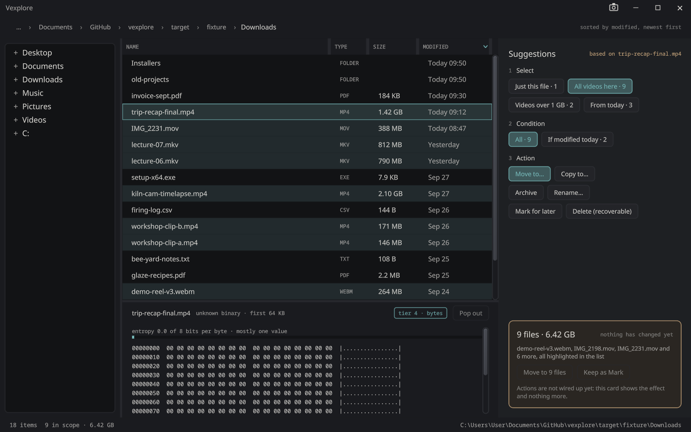

# Vexplore

A file explorer that suggests instead of asking. Built on [vexelray-gui](../vexelray-gui) through
[vexelray-framework](../vexelray-framework), and deliberately a **framework witness**: every gap it finds goes into
the framework's own `docs/TODO.md`, and the reusable parts go into `vexelray-gui-widget` rather than staying here.

**Install it** on Windows, with the other VexelRay applications, from [sibarum.github.io](https://sibarum.github.io/).

- **The design** — [docs/design/README.md](docs/design/README.md) holds the principles and they are the
  requirements; [HANDOFF.md](docs/design/HANDOFF.md) holds the numbers; the mockups only show one way of drawing them.
- **What is needed** — [docs/components.md](docs/components.md): which GUI components the interface needs, which
  existed, which were added, which are still missing.
- **What is not done** — [docs/TODO.md](docs/TODO.md).
- **What it might become** — [docs/ideas/](docs/ideas/): [git](docs/ideas/git.md) as a primary feature,
  [a web page as a folder](docs/ideas/web-page-as-folder.md),
  the [providers](docs/ideas/providers.md) contract it points to, and the first provider,
  [a Java references explorer](docs/ideas/java-references.md).
- **What the framework did to us** — [docs/framework-notes.md](docs/framework-notes.md), and the framework-side
  account in `vexelray-framework/docs/TODO.md`, *Found by Vexplore*.



*Screen 01, from `docs/scenes/01-select.txt`: a click on one video, a click on "All videos here", a click on
"Move to…". The nine rows a suggestion would reach are marked, not selected; the card states the effect first.*

## Status

**Milestone 1 — read-only browsing, the rail stating its effect.** Done.
**Milestone 2 — actions and modifier keys.** Done, with the exceptions in the table.

| Works | Not yet |
| --- | --- |
| Tree of the user's folders and drives, lazy | Rename by pattern (one name at a time works) |
| Breadcrumb, sortable resizable file list, range selection | Marks do not survive a restart |
| Suggestion Rail: **Select**, **Condition**, **Action**, and a card that states the effect first | The folder dialog has never been opened by a person (see TODO) |
| **Shift** held: where the range likely ends, in the order shown. **Control** held: the rule the picks are examples of. Same slot as the ordinary chips; ignoring them costs nothing | A modifier cannot be held from `ottermate`, so the live behaviour is checked by unit tests and `-Dvexplore.hold=` captures |
| **Move, Copy, Archive, Delete, Mark.** Each plans first (counts, bytes, what would be left alone and why), runs off the frame loop, and can be undone with Ctrl+Z or the Undo button | Fresh-file highlighting; dragging onto the tree, or to and from other applications |
| **Two folders**: the top bar's *Two folders* swaps the Suggestion Rail for a second file list, and the two lists share the width equally. Drag rows from one to the other, or onto a folder row, to move them. They are copied across drives, to or from a server, or with Ctrl held; Shift forces a move. Each drop says what it did on the status line and is undone by Ctrl+Z. The tree opens folders in whichever side was used last, marked by the accent strip at its top | The design's comparison: a status per row, suggestions from it, and the rail beside both lists rather than swapped out (see TODO) |
| Suggested destinations: the neighbouring folder that already holds that kind | A history of destinations |
| Delete goes to Vexplore's own trash (`~/.vexplore/trash`), so it is recoverable | Inline row previews, PDF/video/audio previews, preview tier 2 |
| Preview Dock: images (tier 1: PNG, JPEG, GIF, WebP, SVG and the rest, animated where the file is), text (tier 3), bytes (tier 4) | Any test of the layout itself |
| **Viewer**: an image opens in [Pix](../Pix) when Pix is installed (Enter, double-click, a click on the dock's picture, *View in Pix* in the row menu); without Pix, the same opens Vexplore's own viewer window, the same tree as Pix's, from `vex-suite-common`. ←/→, Home/End and PgUp/PgDn step through the folder's images and move the selection with them; Esc closes. Backdrop: dark, light, checker, magenta, green. Holding an arrow key decodes only where it stops, and the next images are read ahead | Zoom and pan; the viewer forgets its backdrop and size on close |
| **Git status** inside a repository: a GIT column (*modified*, *staged*, *part-staged*, *added*, *untracked*, *ignored*, *conflict*; a folder counts what is changed beneath it) and the branch in the status line, from the `git` executable, asked after the listing so it never holds the rows up. Without git, or outside a repository, nothing | Git on the rail, staging, refresh without navigating, and the column hidden outside a repository (see TODO) |
| **Remote folders over SFTP**: hosts from `~/.ssh/config` in the tree, `sftp://` and `user@host:path` addresses, through your own `ssh` (see below). Listing, the Preview Dock, opening (a downloaded copy), **Download**, **Upload**, **Rename**, **New folder** and a **Delete** into a trash on the server, all undoable. On a remote folder the rail switches to its remote panel | Moving or archiving between a server's own folders; password prompts; a host typed into the tree; cancelling a large transfer (see TODO) |
| 110 tests here, 30 in `vex-suite-common` and 24 in `vexelray-codec`, none of which needs a window (the image ones decode for real, through imagelib; the git ones run git against a fresh repository, and skip without it) | |

Everything the design says a screenshot cannot show holds: nothing covers anything else, the rail is a fixed
column that may be empty, a suggestion arriving or leaving moves no row, ignoring a suggestion costs nothing, and
every action states what it will affect before it runs and is recoverable. The one exception is a drag between two
folders: it is recoverable, but says what it left alone only after it lands (see TODO).

## Run it

```
mvn compile exec:exec
mvn compile exec:exec -Dapp.jvmArgs=-Dvexplore.folder=C:/Users/me/Downloads
mvn test
```

Needs the stack installed to the local Maven repository first, in the order in
[vexelray-gui/CLAUDE.md](../vexelray-gui/CLAUDE.md). `exec:exec` rather than `exec:java` so native access can be
enabled for Panama.

Startup properties, for a known state (see `Startup`): `vexplore.folder`, `vexplore.select` (comma-separated
names), `vexplore.scope`, `vexplore.act`, `vexplore.hold`, `vexplore.trash`, `vexplore.home` (where step 4 looks for
Pictures, Videos and the pile folders; the scenes point it at the fixture), `vexplore.other` (a folder to open as the
second of two folders), and `vexplore.sync=true` to list on the calling thread.

A path on the command line wins over `vexplore.folder`: `vexplore <folder>` opens it, and `vexplore <file>` opens the
folder it is in with that file selected. That is how the suite's other apps say "show this here".

## Remote folders: SSH and SFTP

`vexplore sftp://me@box/srv/logs` (or `vexplore me@box:logs`, scp's form) opens a folder on another machine, and the
hosts named in `~/.ssh/config` sit under the drives in the tree and in the title bar's **Open** menu; choosing one
connects and opens its home folder. The Open menu (the folder icon beside the title) also has Open folder…, New window
here, and Home, Desktop, Documents and Downloads.

Vexplore does not do SSH itself. It starts your `ssh` as `ssh -T -o BatchMode=yes -s <host> sftp` and speaks SFTP
over its pipes (`remote/Sftp`), the way it runs `git`: so your config, agent, keys, known hosts and jump hosts all
apply, and nothing in Vexplore ever holds a password. `BatchMode` means a host that would prompt refuses instead,
and the rail shows ssh's own reason. `vexplore.ssh` names another `ssh`.

A remote folder is a `java.nio.file` file system (`remote/RemoteProvider`), so the list, tree, breadcrumb, Preview
Dock and Select/Condition chips work unchanged, and so do `Operations`: a copy to a server is `Files.copy` into an
SFTP write, a rename there is SFTP's `RENAME`, which refuses rather than overwrite. What changes is the Suggestion
Rail, which has a **remote panel**:

- **Nothing selected:** the address, whether the host answered (and if not, why), and where to go next: home, up
  one folder, the config's other hosts, back to this computer, or an address typed in and Enter. Once connected,
  **New folder**: a name and Enter, undone by Ctrl+Z while the folder is still empty.
- **Something selected:** Select and Condition as usual, then four actions, each planned and stated first and each
  undone by Ctrl+Z:
  - **Download to…** — a copy on *this* computer (step 4 offers Pictures or Videos for the kind, Downloads,
    Desktop).
  - **Rename…** — one item; type the new name and press Enter, and the card says what it becomes before the Rename
    button does it. The same Rename now works on this computer's folders too.
  - **Delete (recoverable)** — into `.vexplore-trash` in your home folder *on that server*, so a delete is a rename
    there rather than a download here, and Ctrl+Z renames it back.
  - **Mark for later.**

**Uploading** is Copy to… (or Move to…) from a folder on this computer: the remote folder you were last in is
offered in step 4 as "on <host>, where you were", for as long as that host stays connected.

Opening a remote file (Enter, Open in Vex, Pix) downloads it to `~/.vexplore/remote/<host>/…` first and opens the
copy, fetching again only when the server's size or time differ. Saving that copy does not change the server.

For tests and captures, `vexplore.sftp.server=<path to sftp-server>` serves every host from a local `sftp-server`
instead of `ssh`; Git for Windows ships one at `usr/lib/ssh/sftp-server.exe`, and `RemotesTest` uses it.

## Opening a file, and the suite

Enter or a double-click on a file opens it. Text and source (whatever the Preview Dock shows as text) go to the
suite's text editor, started as `text-editor <file>` in a new window, and pictures (named like what imagelib
decodes) to Pix, as `pix <file>`; everything else, and anything whose application is not installed, goes to the
shell's own open, as in Explorer. The dock's header has *Open in Vex* for a text file, and says *Vex not installed*
instead when it is not; for a picture the picture itself is the control: a click on it, or Enter while it has the
focus, views it in Pix, or in Vexplore's own viewer without Pix. Its mat and the pop-out icon off its corner say so, and
answer the pointer with the words for where it goes.
Both are found through their install records (`vexelray-installer`, read by the framework's `Apps`), so they have
to be installed; a run from the checkout still finds installed ones, and `INSTALL_REGISTRY_DIR` points the lookup
somewhere else for a test.


### Looking at it without a person

A folder that looks like the first mockup's Downloads, and scripts that drive the real window through the
framework's automation socket. Every control a scene needs has a landmark (`act.move`, `go`, `undo`, `dest.1`), so a
scene does not depend on where anything is drawn:

```
sh docs/scenes/fixture.sh
java -jar ../vexelray-gui/vexelray-gui-automation-cli/target/vexelray-gui-automation-cli-0.1.0-SNAPSHOT.jar \
     --script docs/scenes/02-move.txt --launch mvn.cmd -q exec:exec -Dautomation=0 \
     "-Dapp.jvmArgs=-Dvexplore.folder=target/fixture/Downloads -Dvexplore.trash=target/fixture/trash -Dvexplore.home=target/fixture"
```

`01-select` is the first mockup; `02-move` moves nine videos to the folder that already holds videos and then undoes
it; `03-delete-and-mark` does the same for a delete and keeps a mark. A scene never sleeps: every document change
writes the status line last, and the card's primary button names what it is about to do, so a scene `await`s those —
see FN-4 in [framework-notes.md](docs/framework-notes.md) for why `settle` is not enough. A headless still, with no
window, is `-Dapp.args="--capture out.png"` (use `C:/...` paths, not `/c/...`); `-Dvexplore.hold=shift` or `control`
puts the model as though that key were down, which `ottermate` cannot do.

## How it is put together

```
files/     the file system, and nothing else. Entry, Kind, Folders (the only reader), Preview, Previews (whose
           first tier is the suite's Pictures), Destinations. No GUI.
           Blocking: callers run these on Gui.offload().
suggest/   the rail's brain, as pure functions: Suggestions (Select/Condition/Action), Intents (what Shift and
           Control are announcing), Order (the sort, shared with the table). Tested against a folder that is a
           list of values.
ops/       Plan (what an action would do, a value the card can draw) and Operations (doing it, and undoing it).
           Tested against real temporary folders.
Model      the one state (Doc: input + work + the rest), the only way to change it, and an onChange that never
           delivers an older document after a newer one.
Browser    navigate + list off the frame loop; a listing for a folder you have left is dropped.
Previewer  keeps the dock matching the selection, same rule: one worker, latest request wins, recent decoded images
           kept (an LRU by bytes), and while the viewer is open a second size and the neighbours read ahead.
           Destinator does the same for destinations.
Viewer     the image viewer: the suite's PictureViewer in a window of its own. Steps change the selection, so
           everything else follows.
Actor      the one place a button becomes a change to the disk: run, undo, mark, choose a destination (the
           framework's Dialogs pick the folder).
Ui, RailView, Dock   the tree. Hold no application state, only a cache of what they last drew.
Look       colour: the suite's palette (SuiteLook), and the explorer's own tokens beside it.
Recipes    what is built; the wiring is generated from it.
```

The image parts are shared. [`vexelray-codec`](../vexelray-codec)'s image module has the pictures: `Pictures` and
`Picture` (decoding and packing), `Textures`, `ImageView` and `Lru`, and `ImageStarter`, which `VexploreApp` names so
the textures are built and bound to the window. [`vex-suite-common`](../vex-suite-common), shared with Pix, has the
sizes they are decoded at, `Filmstrip`, `Tile`, `Icons`, `PictureViewer` (the whole viewer tree) and the palette.
Both are sibling checkouts installed to the local Maven repository (`mvn install`) before this one builds.

The rule the layout keeps is the design's: **nothing is drawn over anything else.** There is no popup, tooltip or
overlay anywhere in `Ui`, with one exception: a file name too long for its column is shown whole while it is hovered,
over the columns beside it. It was already covered by them, so hovering only chooses which of the two is covered. A
change to the rail rewrites the rail's column and touches nothing else.

## Plan

1. **Milestone 1** — read-only, rail states its effect. *Done.*
2. **Milestone 2 — actions, and modifier keys as intent signals.** *Done* except Rename, persistence of marks,
   and having watched a person use the folder dialog.
3. **Milestone 3 — the drag fallback and fresh files.** Drag a row, the *Carrying* card, destinations with reasons;
   a five-second-old file highlighted amber.
4. **Milestone 4 — previews up the ladder.** Inline row previews, CSV/JSON/archive, images (*done*), PDF, pop-out
   (*done for images: the viewer*).
5. **Milestone 5 — Two Folders.** The comparison engine and its open question about "identical".

Priorities are the author's to move. The design is a set of principles, and where a mockup and a principle
disagree the principle wins.

## Reading order for a newcomer

`docs/design/README.md` → `docs/components.md` → `suggest/Suggestions.java` (the whole idea, in 200 lines with no
GUI in it) → `Ui.java` → `docs/framework-notes.md`.

## Native builds

Windows, GraalVM 25 as `JAVA_HOME`, from a Visual Studio developer prompt (or after `vcvars64.bat`) so `link.exe` is
MSVC's and not Git Bash's. Two profiles build the same code as two editions:

```
mvn -Pnative-release package -DskipTests   # target/vexplore.exe        what ships and is signed
mvn -Pnative package -DskipTests           # target/vexplore-debug.exe  for ottermate
```

- **release** (`installer.json` points at this one): linked as a Windows GUI subsystem program, so no console window
  ever appears, and built without the automation module: the source root `src/edition-release` is compiled instead
  of `src/edition-debug` and `vexelray-*-automation` is not on its classpath, so the binary cannot open a driving
  socket (`--automation` is accepted and does nothing). stdout and stderr go nowhere; the log files are still written.
- **debug**: console subsystem, automation present: `vexplore-debug.exe --automation=0` prints
  `automation: localhost:<port>` for `ottermate --launch`.

The plain JVM build, tests and `exec:exec` are the debug edition. The linker options are
`/SUBSYSTEM:WINDOWS|CONSOLE` and `/ENTRY:mainCRTStartup` (pom, `pluginManagement`). Both profiles also link
`src/main/rc/vexplore.rc`, the executable's icon, compiled by `rc.exe`. The icon is the suite icon canvas's Vexplore
(`src/main/rc/vexplore.svg`, with its window, file and light variants beside it), rendered to `vexplore.ico` by
`vex-suite-common`'s `tools/Ico.java`.
